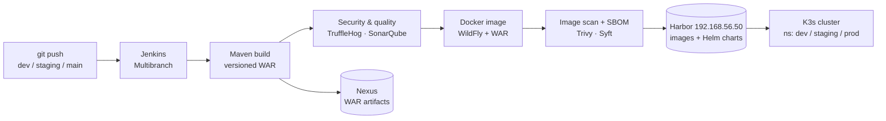
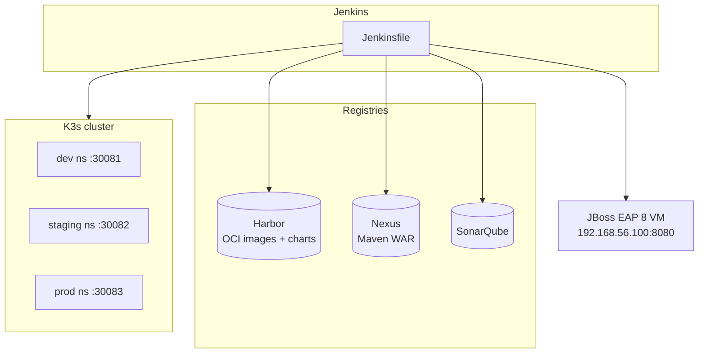

# Hercey — DevOps & CI/CD Platform


> ### Ownership & scope
> The **Hercey application** (the Java/JBoss e‑commerce backend and its web UI) was built by
> **[Nimuthu](https://github.com/Nimuthu)**.
>
> **Everything DevOps in this repository is my work ([Kithupa G](https://github.com/KithupaG))** —
> the CI/CD pipeline, containerization, Helm packaging, artifact management, security/quality
> gates and the multi‑environment deployment platform. This README documents that platform.
> The application source is included here only because the pipeline builds and ships it.

An end‑to‑end **build → scan → package → deploy** platform for a JBoss/WildFly Java application.
Every commit flows through a Jenkins multibranch pipeline that produces a versioned WAR, a
container image **and** a Helm chart, publishes both to **Harbor** (OCI), and deploys to a
**K3s** cluster and a **JBoss EAP** VM — with secret scanning, static analysis, SBOM and DAST
wired in along the way.

**Harbor is the single source of truth** for both the image and the chart: CI never deploys from
a local build context, it deploys the exact artifact that was scanned and published.

---

## My role / DevOps responsibilities

| Area | What I built |
|------|--------------|
| **CI/CD** | Jenkins Multibranch Pipeline (`Jenkinsfile`) — one file, branch‑driven environment promotion |
| **Containerization** | WildFly Dockerfile; image build, tagging and push to Harbor |
| **Artifact management** | Versioned WAR publishing to Nexus; OCI Helm chart push/pull to/from Harbor |
| **Packaging & deploy** | Helm chart (`helm/hercey`) and `helm upgrade --install` from Harbor OCI into K3s |
| **Configuration** | Externalized all secrets to environment variables (`.env` / Kubernetes Secret) |
| **Security** | TruffleHog secret scan, Trivy filesystem/image/K8s scans, Syft SBOM, OWASP ZAP DAST |
| **Quality** | SonarQube analysis + blocking quality gate |
| **Release control** | Manual production approval gate, rollback‑on‑failure, versioned releases |
| **Legacy VM deploy** | WAR deployment to a JBoss EAP 8 VM over SSH with backup & automatic rollback |
| **Platforms** | Harbor, Nexus, SonarQube, K3s, JBoss EAP VM provisioned and wired together |

---

## Architecture

### Delivery pipeline



### Runtime topology



---

## Tech stack

| Layer | Tooling |
|-------|---------|
| CI server | Jenkins (Multibranch Pipeline), Maven toolchain, NodeJS 20.x |
| Application build | Maven 3, Java 17, packaged as `hercey.war` |
| Container | Docker, WildFly (`quay.io/wildfly/wildfly`) |
| Registry / source of truth | **Harbor** `192.168.56.50` (images + Helm charts via OCI) |
| Artifact repo | **Nexus** `host.docker.internal:8081` (`hercey-dev` / `hercey-staging` / `hercey-releases`) |
| Code quality | **SonarQube** (analysis + quality gate) |
| Security scanning | **TruffleHog**, **Trivy** (fs, image, Kubernetes), **Syft** (SBOM), **OWASP ZAP** (DAST) |
| Packaging & deploy | **Helm** (`helm/hercey`), `helm upgrade --install` from Harbor OCI |
| Orchestration | **K3s** single‑node cluster |
| Legacy runtime | **JBoss EAP 8** on a dedicated VM, deployed over SSH via `jboss-cli.sh` |
| Database | MySQL |
| App frameworks | Hibernate ORM 6, Jersey (JAX‑RS), Jakarta Mail, static HTML/JS web UI |

---

## CI/CD pipeline

Defined in [`Jenkinsfile`](Jenkinsfile). A single pipeline runs on all branches; the branch name
selects the target environment automatically (`Load environment config` stage), so promoting
`dev → staging → main` never changes behaviour or credentials by accident.

| # | Stage | Purpose | dev | staging | main |
|---|-------|---------|:---:|:-------:|:----:|
| 1 | Load environment config | Branch → env, versions, registry/creds mapping | ✓ | ✓ | ✓ |
| 2 | Checkout Source Code | `checkout scm` | ✓ | ✓ | ✓ |
| 3 | Secret Scanning (TruffleHog) | Detect leaked credentials (custom detectors) | ✓ | ✓ | ✓ |
| 4 | SonarQube Analysis | Static analysis | ✓ | ✓ | ✓ |
| 5 | SonarQube Quality Gate | Block on failed gate (enforced for stg/prod) | ✓ | ✓ | ✓ |
| 6 | Build WAR (dynamic versioning) | `mvn package` with pipeline version | ✓ | ✓ | ✓ |
| 7 | Trivy Security Scan | Filesystem vuln/misconfig/secret/license + SBOM | ✓ | ✓ | ✓ |
| 8 | Build Docker Image | WildFly + WAR | ✓ | ✓ | ✓ |
| 9 | Image Scan & SBOM | Trivy image scan + Syft SBOM | ✓ | ✓ | ✓ |
| 10 | Approve production release | Manual password gate | — | — | ✓ |
| 11 | Publish Artifact to Nexus | Upload versioned WAR | ✓ | ✓ | ✓ |
| 12 | Push image to Harbor | Push image, per‑env robot account | ✓ | ✓ | ✓ |
| 13 | Package & Push Helm chart to Harbor | `helm package` + `helm push` (OCI) | — | ✓ | ✓ |
| 14 | Deploy with Helm | `helm upgrade --install` from Harbor, rollback on failure | — | ✓ | ✓ |
| 15 | Trivy Kubernetes Audit | Post‑deploy cluster audit (HTML report) | — | ✓ | ✓ |
| 16 | Wait for App Readiness | Poll `/health` before DAST | — | ✓ | ✓ |
| 17 | Deploy WAR to JBoss EAP VM | SSH deploy with backup + automatic rollback | — | ✓ | ✓ |
| 18 | DAST Security Scan (OWASP ZAP) | Baseline scan against the live app | — | ✓ | ✓ |

**Behaviour by branch**

* **`dev`** — builds, scans and publishes artifacts (Nexus + Harbor image). No deploy.
* **`staging` / `main`** — fully deploys, audits, health‑checks and DAST‑scans.
* **`main` (production)** — requires a manual approval before publishing.

### Versioning

`MAJOR_MINOR` is fixed at `1.0`; the build number supplies the patch:

| Branch | Maven version | Image tag | Chart version |
|--------|---------------|-----------|---------------|
| dev | `1.0.<build>-SNAPSHOT` | `dev-1.0.<build>` | — |
| staging | `1.0.<build>-rc` | `staging-1.0.<build>` | `1.0.<build>-rc` |
| main | `1.0.<build>` | `1.0.<build>` | `1.0.<build>` |

---

## Environments

| Branch | Kubernetes namespace | Harbor project | NodePort | Deploys? |
|--------|----------------------|----------------|:--------:|----------|
| `dev` | `dev` | `hercey-dev` | 30081 | artifacts only |
| `staging` | `staging` | `hercey-staging` | 30082 | automatic |
| `main` | `prod` | `hercey` | 30083 | automatic (after approval) |

Each environment gets its own namespace, Harbor project/robot account, Nexus repo, SonarQube
project key and NodePort — all selected from the branch.

---

## Security & quality gates

* **TruffleHog** — scans the repository with custom detectors for XML/properties password
  patterns; report rendered to HTML via [`scripts/generate_trufflehog_report.py`](scripts/generate_trufflehog_report.py).
* **SonarQube** — analysis runs on every branch; the **quality gate is blocking** for
  `staging`/`main` and non‑blocking (unstable) for `dev`.
* **Trivy** — filesystem scan (vuln, misconfig, secret, license), container image scan and a
  post‑deploy Kubernetes audit. Accepted findings are documented in [`.trivyignore`](.trivyignore).
* **Syft** — generates CycloneDX SBOMs for the built image.
* **OWASP ZAP** — baseline DAST against the running app after a health check passes.
* Trivy high/critical enforcement is currently **advisory** (report‑only, exit codes are
  intentionally disabled so the pipeline keeps shipping while the vulnerability baseline is
  triaged and can be re‑enabled later).

All reports (Trivy, SBOM, TruffleHog, ZAP) are published as Jenkins HTML reports and archived
as build artifacts.

---

## Configuration & secrets

No credentials live in the source tree. The application reads mail and database settings from
**environment variables** at runtime: `Env` resolves `${VAR}` placeholders in
[`app.properties`](src/main/resources/app.properties) and
[`hibernate.cfg.xml`](src/main/resources/hibernate.cfg.xml). A local `.env` file is used for
development (see [`.env.example`](.env.example)); the chart injects the same variables into the
pod.

```bash
# Local development
cp .env.example .env      # then fill in real values

# Kubernetes: create a Secret from the env file, then point the chart at it
kubectl create secret generic hercey-env --from-env-file=.env -n <env> \
  --dry-run=client -o yaml | kubectl apply -f -

helm upgrade --install jboss-app oci://192.168.56.50/<project>/charts/hercey \
  --namespace <env> --set envFrom[0].secretRef.name=hercey-env
```

The chart maps `values.env` (plain key/value) to container `env:` and `values.envFrom` to
container `envFrom:`. See the [Helm chart](helm/hercey) for details.

**Jenkins credentials required** (IDs referenced by the pipeline): `jenkins-dev-robot`,
`jenkins-staging-robot`, `jenkins-robot` (Harbor robots), `nexus-credentials`, `k8s-kubeconfig`,
`jboss-vm-ssh-key`, `prod-approval-secret`.

---

## Repository structure

```text
.
├── Jenkinsfile                 # Multibranch pipeline definition (the heart of the platform)
├── Dockerfile                  # WildFly image build
├── pom.xml                     # Maven WAR build
├── .env.example                # Required runtime environment variables (no secrets)
├── helm/
│   └── hercey/                 # Helm chart SOURCE (packaged + pushed to Harbor by CI)
│       ├── Chart.yaml
│       ├── values.yaml
│       └── templates/
│           ├── deployment.yaml
│           └── service.yaml
├── harbor-charts/              # Charts PULLED from Harbor OCI (packaged artifacts)
│   ├── INDEX.md                # Catalog: versions, digests, push dates
│   ├── hercey-<version>.tgz    # Exact OCI artifacts
│   └── extracted/<version>/    # Unpacked charts for review
├── archive/                    # Retired/earlier assets recovered from outside the repo
│   ├── k8s-fleet-config/       # Old Rancher Fleet + Kustomize GitOps manifests
│   └── jboss-container/        # Old standalone JBoss EAP image build
├── scripts/                    # Pipeline helper scripts (TruffleHog HTML report)
├── templates/                  # Trivy HTML report template
├── Docs/                       # Application documentation (see below)
├── trufflehog-config.yaml      # Custom secret-scan detectors
├── .trivyignore                # Accepted/ignored vulnerabilities
└── src/                        # Application source (built by the pipeline)
```

---

## Deploy & rollback

Jenkins deploys the published chart from Harbor (never a local build):

```bash
helm upgrade --install jboss-app \
  oci://192.168.56.50/<project>/charts/hercey \
  --version <version> \
  --namespace <env> --create-namespace \
  --set image.repository=192.168.56.50/<project>/hercey \
  --set image.tag=<image-tag> \
  --set service.type=NodePort --set service.nodePort=<nodePort> \
  --plain-http --wait --rollback-on-failure --take-ownership --force-conflicts
```

`--rollback-on-failure` reverts automatically if the release doesn't become healthy. Manual
rollback:

```bash
helm history  jboss-app -n <env>
helm rollback jboss-app -n <env>
```

The JBoss EAP VM path deploys the WAR over SSH (`scp` + `jboss-cli.sh deploy --force`),
backing up the current WAR first and restoring it automatically if the deploy fails.

---

## Local development

```bash
# Kubernetes Fleet GitOps Deployment Repository

This repository implements a GitOps-based deployment pipeline for the **JBoss Application (`jboss-app`)** using **Rancher Fleet**, **Kustomize**, and **K3s**. It manages multi-environment deployments (`staging` and `prod`) from a single centralized repository.

---

## Architecture & Tech Stack

* **Orchestration / GitOps:** Rancher Fleet (`fleet.yaml`)
* **Configuration Management:** Kustomize (Base and Environment Overlays)
* **Kubernetes Platform:** K3s Single-Node Cluster
* **Application:** JBoss Enterprise / WildFly Container (`jboss-app`)

---

## Repository Structure

```text
.
├── apps/
│   └── jboss-app/
│       ├── fleet.yaml               # Fleet multi-target configuration
│       ├── base/                    # Shared Kubernetes manifests
│       │   ├── deployment.yaml
│       │   ├── service.yaml
│       │   └── kustomization.yaml
│       └── overlays/                # Environment-specific configurations
│           ├── staging/
│           │   └── kustomization.yaml
│           └── prod/
│               └── kustomization.yaml
```

---

## Fleet Target Configuration (`fleet.yaml`)

Fleet uses `targetCustomizationMode: AllMatches` to evaluate both staging and production targets concurrently against the cluster labels:

```yaml
targetCustomizationMode: AllMatches
targetCustomizations:
  - name: staging
    clusterSelector:
      matchLabels:
        staging-env: "true"
    kustomize:
      dir: overlays/staging
    namespace: staging

  - name: prod
    clusterSelector:
      matchLabels:
        prod-env: "true"
    kustomize:
      dir: overlays/prod
    namespace: prod
```

---

## Cluster Prerequisites & Labeling

For Fleet to successfully target and deploy resources to your K3s cluster, ensure the cluster object in the `fleet-local` namespace is properly labeled with both environment flags:

```bash
kubectl label clusters.fleet.cattle.io local staging-env=true prod-env=true -n fleet-local --overwrite
```

Verify the labels have been successfully applied:
```bash
kubectl get clusters.fleet.cattle.io local -n fleet-local -o jsonpath='{.metadata.labels}'
```

---

## Verifying Deployments

Once Fleet syncs the repository, you can verify the status of the bundle deployments across your cluster:

```bash
kubectl get bundledeployments -A | grep hercey-k8s-deployment
```

Check that the pods and deployments are running successfully in both namespaces:

```bash
kubectl get deploy,pods -n staging
kubectl get deploy,pods -n prod
```
